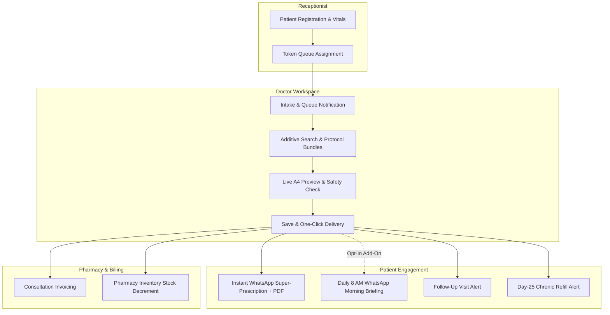

# 📘 RxNXT — Product Capabilities, Architecture & Pricing Blueprint

> **Prepared for:** Product Management, Commercial Strategy & Pricing Teams  
> **Platform:** RxNXT Cloud (Clinic Operating System & Patient Adherence Engine)  
> **Market:** Indian Outpatient Clinics, Polyclinics, Multi-Specialty OPDs & Solo Practitioners  
> **Date:** October 2026 | **Version:** 1.1 (Updated)

---

## Executive Summary

**RxNXT** is a cloud-native, high-speed **Clinic Operating System (Clinic OS)**, digital prescription engine, and automated patient communication platform. It bridges the gap between **fast consultation workflows for doctors** and **patient medication adherence via WhatsApp**.

Unlike legacy Electronic Health Record (EHR) systems that slow down doctors with tedious multi-screen forms, RxNXT allows a doctor to generate a complete electronic prescription in **under 30 seconds**. The patient instantly receives an official prescription PDF and schedule directly on their WhatsApp without installing any mobile app.

---

## 1. What RxNXT Actually Does (Core Functional Modules)



---

### Module 1: High-Speed Clinical Prescription Workspace (`/doctor/prescription`)
*Target User: Doctors, Specialists, Medical Officers*

* **Intelligent Additive Drug Search:**
  * **Short-circuit alias search:** Typing `"PCM"` instantly returns Paracetamol.
  * **Adaptive Habit Scoring:** Frequently prescribed drugs by the specific doctor receive a +50 weight boost; clinic-standard drugs receive a +20 boost.
  * **Typo-tolerant Fuzzy Search:** Powered by Fuse.js for rapid brand and generic matching.
* **1-Click Clinical Protocol Bundles:** Pre-configured treatment templates (e.g., *Viral Fever Protocol, Type-2 Diabetes Care, Acute Gastritis, Hypertension Starter*) that populate complete medication regimes, dosages, and instructions in 1 click.
* **Live Sticky A4 Preview Rail:** Real-time visual representation of the printed prescription alongside the prescription editor, ensuring what the doctor sees is exactly what the patient receives.
* **Clinical Safety & Telemedicine Compliance:**
  * **Schedule X / Narcotic Blocking:** Automatically restricts narcotic and habit-forming drugs from telemedicine dispatches in strict compliance with the **Telemedicine Practice Guidelines**.
  * **Mandatory Dosage Fields:** Enforces frequency, duration, and instructions to eliminate dispensing ambiguity.
* **Instant Client-Side PDF Generation (`jsPDF`):**
  * Generates branded, print-ready PDFs in **<250ms** directly inside the doctor's browser.
  * Incorporates doctor digital signature, registration number, qualifications, clinic letterhead, and a tamper-evident QR verification code.

---

### Module 2: Receptionist Queue & Triage Desk (`/receptionist/dashboard`)
*Target User: Receptionists, Triage Nurses, Front-desk Staff*

* **Fast Registration & Duplicate Prevention:** Quick-entry form for patient details (Name, Age, Gender, Mobile). Auto-sanitizes Indian mobile numbers (+91) and alerts if a patient is already registered.
* **Live Token Queue System:** Generates sequential daily tokens (`#RX-001`, `#RX-002`) and tracks patient status (`WAITING`, `IN_PROCEDURE`, `RETURNED_READY`, `COMPLETED`).
* **Vitals Triage Entry:** Front-desk recording of Blood Pressure (BP), Pulse, Temperature, Weight, Height, and SpO2. Vitals seamlessly populate onto the doctor's consultation screen and final prescription PDF.

---

### Module 3: Automated WhatsApp Patient Communication (`services/whatsappService.ts`)
*Target User: Patients & Family Members (Zero App Download Required)*

* **Official Meta WhatsApp Cloud API (Graph API v20.0):**
  * Direct enterprise integration bypassing third-party aggregators (Twilio/SMS gateways).
  * 100% compliant with approved Meta Utility message templates.
* **Instant Super-Prescription Message:** Dispatches immediately upon consultation with a complete medication breakdown (Morning, Afternoon, Night doses) and a direct link to download the official PDF.
* **Automated Daily Morning Briefing (8:00 AM IST):**
  * Gathers the **complete day's doses** (Morning + Afternoon + Night) into a single, clean morning briefing.
  * Eliminates spam while ensuring patients never miss afternoon or bedtime medications.
* **Follow-up Visit Reminders:** Scheduled automatically for the exact follow-up date specified by the doctor.
* **Chronic Care Monthly Refill Alerts:** Fires on Day 25 for patients on long-term courses (>14 days), driving clinic consultation retention.
* **DPDP Act & Consent Compliance:** Logs patient WhatsApp consent during registration and honors immediate unsubscribe if a patient replies `"STOP"`.

---

### Module 4: In-House Clinic Pharmacy & Dispensing (`/pharmacist/*`)
*Target User: In-house Pharmacists, Clinic Dispensary Staff*

* **Inventory & Stock Management:** Tracks medicine batches, expiry dates, rack locations, unit cost prices, and MRP selling prices.
* **Low Stock & Expiry Alerts:** Real-time visibility into medicines nearing reorder threshold or shelf expiry.
* **1-Click Prescription Dispensing:** Pharmacy dashboard displays prescriptions generated by clinic doctors. Dispensing automatically decrements inventory stock and creates an auditable `DispenseLog`.

---

### Module 5: Billing & Invoicing Desk (`/admin/billing`, `app/api/billing`)
*Target User: Receptionists, Cashiers, Clinic Administrators*

* **Comprehensive Invoicing:** Combines doctor consultation fees, dispensed pharmacy charges, procedure fees, and discretionary discounts.
* **Payment Tracking:** Supports multiple payment modes (`CASH`, `UPI`, `CARD`) with transaction reference tracking and printable invoice generation.

---

### Module 6: Clinic Administration, Staff & Practice Management (`/admin/*`)
*Target User: Clinic Owners, Lead Doctors, Practice Managers*

* **Direct Doctor Onboarding:** Zero-friction doctor sign-up and clinic workspace provisioning without external registry delays, allowing doctors to self-register and start prescribing immediately.
* **Clinic Profile & Branding Customization:** Upload clinic logo, customize letterhead branding, upload doctor digital signatures, and enter doctor qualifications (`MBBS`, `MD`) and registration details for prescription letterheads.
* **Multi-User Role-Based Access Control (RBAC):** Distinct roles for `doctor`, `clinic_admin`, `receptionist`, `nurse`, `pharmacist`, and `superadmin` with strict multi-tenant clinic data isolation.
* **Practice Analytics:** Tracks patient volume, prescription turnaround time, common diagnoses, and most-prescribed medicines.

---

## 2. Product Team Packaging Strategy: Standard vs. Add-On Model

To maximize customer acquisition while protecting gross margins, features are categorized into **Core / Standard (Included in Base Subscription)** and **Monetizable Add-Ons (Billed Usage / Upsell)**.

```mermaid
graph LR
    subgraph Standard Plan [Standard Subscription Base]
        S1[Doctor Clinical Workspace]
        S2[Receptionist Queue & Vitals]
        S3[Instant WhatsApp Rx Delivery]
        S4[Direct Doctor Onboarding]
        S5[Basic Billing & Invoice]
    end

    subgraph AddOns [Monetizable Add-Ons & Expansions]
        A1[Daily Morning WhatsApp Briefings]
        A2[In-House Pharmacy Inventory Module]
        A3[Multi-Doctor Seat Expansion]
        A4[Clinic Custom WhatsApp Branding]
    end

    Standard Plan --> AddOns
```

---

### Tier Breakdown

| Feature / Capability | Standard Plan (Base) | Growth / Polyclinic | Enterprise / Hospital | Add-On (A La Carte) |
| :--- | :---: | :---: | :---: | :---: |
| **Doctor Prescribing Workspace & Live A4 Preview** | Included (1 Doctor) | Included (Up to 5 Doctors) | Unlimited Doctors | — |
| **Patient Registration & Vitals Queue** | Included | Included | Included | — |
| **Instant WhatsApp Prescription Delivery (with PDF)** | Included | Included | Included | — |
| **Doctor Habit Scoring & Custom Protocols** | Included | Included | Included | — |
| **Follow-Up Appointment Reminder (1 msg / patient)** | Included | Included | Included | — |
| **Basic Consultation Billing (Receipts / Invoices)** | Included | Included | Included | — |
| **Direct Doctor Onboarding & Workspace Setup** | Included | Included | Included | — |
| **Automated Daily Morning WhatsApp Briefings** | *Optional Add-On* | *Optional Add-On* | Included (1,000 msgs) | **₹299 / mo (1,000 msgs cap)**<br>*(Overage: ₹0.25 / msg)* |
| **Chronic Care Refill Reminders (Day 25 Alert)** | *Optional Add-On* | Included | Included | **₹199 / mo (500 msgs cap)** |
| **In-House Pharmacy & Batch Stock Inventory** | — | Included | Included | **₹499 / mo** |
| **Advanced Practice Analytics & Drug Consumption** | — | Included | Included | **₹299 / mo** |
| **Additional Doctor Seat** | — | — | — | **₹2,499 / doctor / year** |
| **Custom Clinic WhatsApp Number (Verified Green Tick)** | — | — | Included | **One-time Setup Fee** |

---

## 3. Detailed Justification for Add-On Structuring & Quota Economics

### Quota Breakdown & Unit Profit Margins for RxNXT

| Add-On Package | Monthly Price | Monthly Quota | Clinical OPD Coverage | COGS (Meta @ ₹0.13 + Gateway) | Net Profit to RxNXT | Gross Margin |
| :--- | :---: | :---: | :--- | :---: | :---: | :---: |
| **Daily Morning Reminders** | **₹299 / mo** | **1,000 messages** | ~250 acute patients (4-day course) OR ~70 chronic patients (14-day cycle) | ₹136.50 | **₹162.50 / clinic / mo** | **54.4%** |
| **Pay-As-You-Go Reminders** | **₹0.25 / msg** | Per message | Pay-as-you-prescribe (Doctor enables per patient) | ₹0.13 | **₹0.12 / msg** | **48.0%** |
| **Chronic Day-25 Refill Alerts** | **₹199 / mo** | **500 messages** | 500 unique chronic patients (1 message/patient on Day 25) | ₹71.00 | **₹128.00 / clinic / mo** | **64.3%** |

### Why "Automated Daily Morning Reminders" MUST Be an Add-On
1. **Direct Variable Cost:** Each WhatsApp template message costs $\approx ₹0.13$ via Meta Cloud API. For a chronic care patient receiving 14 daily briefings, the messaging cost is $\approx ₹1.82$ per patient. A busy doctor seeing 1,000 patients a month could incur ₹1,800+ in messaging fees alone.
2. **Margin Protection:** Keeping daily reminders off by default in the base subscription guarantees an **85%+ gross profit margin** on software subscriptions.
3. **Upsell Mechanics:** Clinics can be sold **Prepaid Reminder Packs** (e.g., ₹999 for 3,000 reminder credits) or subscribed to the **₹299 / month pack (1,000 messages)**.
4. **OPD Reality:** In an average Indian OPD of 750 patients/month, doctors only activate daily reminders for ~25% to 35% of patients (acute infections or complex cases). Therefore, a 1,000-message pack comfortably covers a busy OPD's entire monthly needs with zero overage.

### Why In-House Pharmacy Should Be a Higher Tier or Add-On
1. Not all outpatient clinics dispense medicines in-house (many write prescriptions for external retail pharmacies).
2. Polyclinics and small nursing homes with internal pharmacies have high willingness to pay for batch management, expiry tracking, and direct prescription-to-dispense billing.

---

## 4. Recommended Pricing Tiers for the Indian Market

### Usage-Based Acquisition Engine: "The First 150"
RxNXT has abandoned legacy 14-day calendar trials in favor of a usage-based volume trial:
* **The First 150 Free Prescriptions:** Every newly registered clinic receives 150 free prescriptions with full platform access and zero calendar time limit.
* **Progressive Engagement:**
  * Prescriptions 0–120: Frictionless onboarding and clinical score engine experience.
  * Prescriptions 121–149: Dismissible warning banner tracking remaining balance.
  * Prescription #150: Hard lock modal requiring commercial tier activation before generation.

```text
┌────────────────────────────────────────────────────────────────────────┐
│  RECOMMENDED COMMERCIAL PRICING STRUCTURE (ANNUAL BILLING)            │
├────────────────────────────────────────────────────────────────────────┤
│                                                                        │
│  0. THE FIRST 150 (TRIAL)                  ₹0 Upfront (150 Rx Cap)     │
│     • Full platform features unlocked; strictly gated at 150 Rx        │
│                                                                        │
│  1. SOLO GP (BASE)                         ₹7,999 – ₹9,999 / year       │
│     • 1 Doctor Seat + 1 Receptionist Desk                              │
│     • Unlimited Prescriptions & Instant WhatsApp PDF Deliveries        │
│     • Live Queue, Clinical Protocols & Practice Setup                  │
│                                                                        │
│  2. SPECIALIST (PATIENT ADHERENCE)         ₹14,999 – ₹18,999 / year    │
│     • Everything in Solo GP + Patient Adherence Automation             │
│     • Daily 8 AM Morning Briefings + Day-25 Chronic Care Refill Alerts │
│                                                                        │
│  3. POLYCLINIC HUB                         ₹24,999 – ₹29,999 / year    │
│     • Everything in Specialist + In-House Pharmacy Inventory Module    │
│     • Dispensing Terminal, Stock Alerts & Multi-Seat Doctor Provisioning│
│     • Additional seats available at ₹499 / doctor / month              │
│                                                                        │
│  4. PREPAID WHATSAPP ADHERENCE WALLET      ₹499 (2k) / ₹999 (5k)       │
│     • Dedicated credit wallet for automated adherence utility messages │
│     • Zero-balance failsafe & automated low balance alerts (<100)      │
│                                                                        │
└────────────────────────────────────────────────────────────────────────┘
```

---

## 5. Summary Checklist for Product & Marketing Collateral

When creating brochures, pitch decks, and website pricing pages:

* [x] **Core Hero Message:** *"Write prescriptions in 30 seconds. Deliver to patient WhatsApp instantly. Zero apps needed."*
* [x] **Zero-Friction Doctor Onboarding:** Instant sign-up and clinic workspace creation without administrative delays.
* [x] **Standard vs Add-On Clarity:** Doctor Prescriptions & Instant WhatsApp PDFs are always free/unlimited; Daily adherence dose alerts are flexible add-ons.
* [x] **Cost Advantage:** Bypasses Twilio and aggregator markups, passing pure cost savings to clinic owners.
